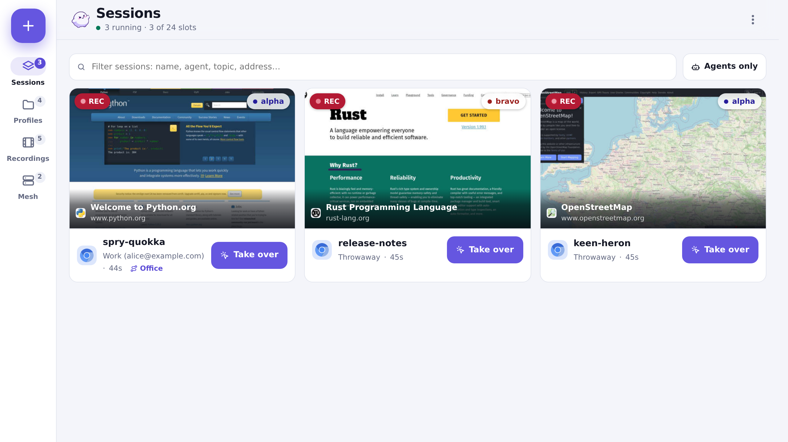

<p align="center">
  
</p>

<p align="center">
  <a href="https://nixbot.brkn.lol/repos/github/pschmitt/browser-daemon"></a>
  <a href="https://my.home-assistant.io/redirect/marketplace_repository/?owner=pschmitt&repository=browser-daemon&category=integration"></a>
</p>

<h1 align="center">browser-daemon</h1>

<p align="center">
  A fast, lightweight, native remote browser daemon written in Rust for CDP automation, AI agents, Firefox WebDriver BiDi, screencasting, and interactive browser handoff across a peer-to-peer cluster mesh.
</p>

<picture>
  <source media="(prefers-color-scheme: dark)" srcset="dashboard-dark.png">
  
</picture>

## Features

- **A browser per connection**, Chromium over CDP (`/chromium`) and Firefox over
  WebDriver BiDi (`/firefox`), for Playwright, Puppeteer and any CDP/BiDi client.
- **Headful in a virtual display**, so bot checks (Botguard, Turnstile) pass.
- **Live view (handoff)** of any tab on phones and desktops: touch and mouse
  input, the phone keyboard, files, downloads, vault logins and passkeys.
- **Recordings** with sound, a scrubbing player, WebM export and merging.
- **Persistent profiles** with free-text names, backups, exports, per-profile
  proxies and automatic idle-profile transfers to a requested node or group.
  See [profile placement](docs/profiles.md#automatic-placement-and-node-groups).
- **Playwright over HTTP**: `POST /api/run` runs a script or a list of steps
  in a session and answers with the result, for clients without Playwright.
- **Home Assistant integration** (Marketplace; HACS custom repository on older
  Home Assistant versions): the mesh's nodes and sessions as
  entities, and actions such as `browser_daemon.run` for automations.
- **A mesh of nodes** with one dashboard, CLI, terminal UI and MCP server for
  AI agents across all of them.
- **Your own desktop browser as a node**: the browser extension shares its tabs
  for live views, recordings and Playwright.
- **Public links** to a running session or a recording.
- **NixOS module**, hardened service, installable PWA.

## Install

On NixOS, add the flake input and enable the service:

```nix
inputs.browser-daemon = {
  url = "github:pschmitt/browser-daemon";
  inputs.nixpkgs.follows = "nixpkgs";
};
```

```nix
{ inputs, ... }:
{
  imports = [ inputs.browser-daemon.nixosModules.default ];
  services.browser-daemon.enable = true;
}
```

Release archives (Linux, glibc and static musl) with checksums and build
attestations are on the [releases page](https://github.com/pschmitt/browser-daemon/releases).
See [docs/nixos.md](docs/nixos.md) for the options and the mesh.

## Quick start

```js
// Playwright against a node: a fresh browser for this connection.
const browser = await chromium.connectOverCDP('ws://127.0.0.1:3001/chromium');
```

```sh
browser-daemon session list        # what runs on the mesh
browser-daemon tui                 # the terminal UI
```

Open `http://127.0.0.1:3001/` for the dashboard and take over any tab in the
live view.

## Documentation

| Topic | |
|---|---|
| [NixOS module](docs/nixos.md) | Options, mesh, resource limits |
| [Automation](docs/automation.md) | CDP and BiDi endpoints, engines, Playwright on shared browsers |
| [Runs](docs/run.md) | Playwright scripts and steps over HTTP, for clients without Playwright |
| [Home Assistant](custom_components/browser_daemon/README.md) | The integration's installation options, entities and actions, `browser_daemon.run` |
| [Live view](docs/live-view.md) | Handoff, downloads, vault logins |
| [rbw vault](docs/rbw.md) | Secret agent, logins and passkeys from rbw, styling |
| [Live-view extensions](docs/extensions.md) | The vault's UI as a sandboxed bundle, its manifest and messages |
| [Recordings](docs/recordings.md) | Sound, merging, keeping |
| [Profiles](docs/profiles.md) | What a profile keeps, transfers, proxies, notes |
| [Public links](docs/sharing.md) | Sharing sessions and recordings |
| [Access control](docs/access-control.md) | Cluster secret, tokens, Host and Origin checks |
| [CLI](docs/cli.md) | Commands and `browser-daemon run` |
| [Terminal UI](docs/tui.md) | `browser-daemon tui` |
| [MCP server](docs/mcp.md) | Browsers for AI agents, `browser_fill_secret` |
| [Behaviour worth knowing](docs/behaviour.md) | Profiles, recording, relay, peers |
| [Browser extension](browser/README.md) | Sharing a desktop browser |
| [Changelog](CHANGELOG.md) | |

## License

GPL-3.0-only. See [LICENSE](LICENSE).
Third-party notices: [THIRD-PARTY.md](THIRD-PARTY.md).
