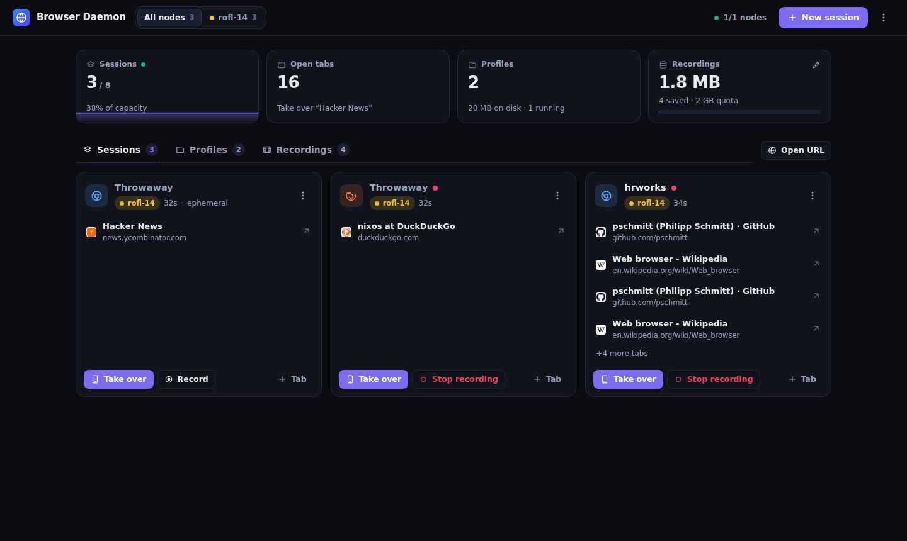
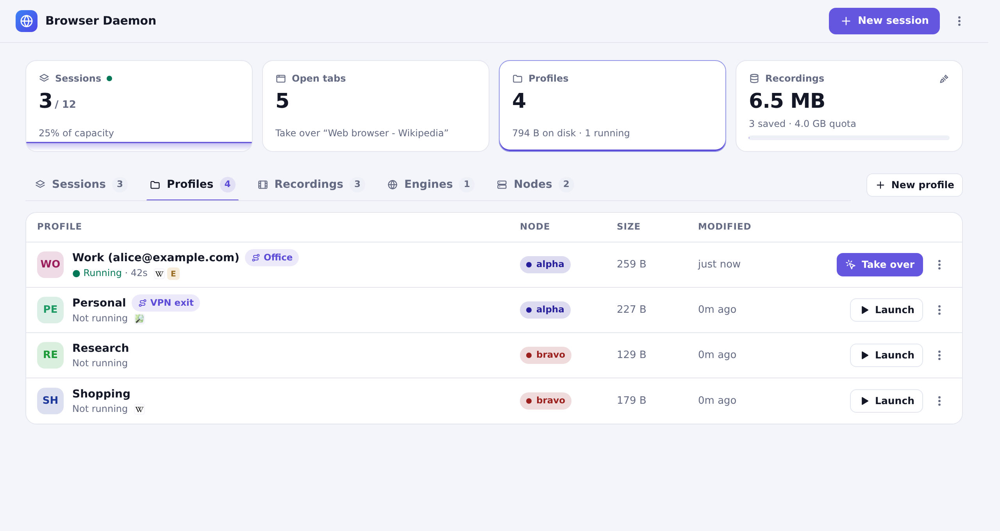

# browser-daemon

A fast, lightweight, native remote browser daemon written in Rust for CDP automation, AI agents, Firefox WebDriver BiDi, screencasting, and interactive browser handoff across a peer-to-peer cluster mesh.



## Features

- **Multi-Tenant Process Isolation:** Spawns an isolated browser instance per incoming connection (`/chromium` for CDP, `/firefox` for WebDriver BiDi). Connections never interfere with one another.
- **Dual Engine Support:** Runs Chromium with native CDP and Firefox with WebDriver BiDi (`/firefox`). Firefox only allows one WebDriver session per process, so the daemon owns it and multiplexes it: any number of BiDi clients (automation, handoff, recorder) can attach to the same Firefox session (`/firefox?session_id=<id>`).
- **Cluster Mesh & Profile Migration:** Discovers peer nodes across Tailscale/wireguard meshes and transfers persistent browser profiles between nodes with live progress toasts.
- **Bot Detection Immunity:** Runs headful Chromium inside an X11 virtual display (`Xvfb`) with `--disable-blink-features=AutomationControlled` natively. Cleanly passes Google Botguard, Cloudflare Turnstile, and other bot detection systems.
- **Session Screencasting & Playback:** Built-in lightweight screencast recorder capturing JPEG frames and metadata, with an interactive scrubbing video player, IndexedDB background downloading, and client-side WebM export.
- **Live Handoff:** Embedded `/handoff/` view of any tab, for phones and desktops. Touch: tap to click, drag to scroll, the phone keyboard mirrors the focused field. Mouse and keyboard: drag to select, double/triple click, Ctrl+C/X/V through the local clipboard, Ctrl+A/Z/Y, arrow keys; a capture button (fullscreen + Keyboard Lock) sends browser shortcuts like Ctrl+W to the page. Files dropped onto the view are dropped into the page (Chromium). Works for both engines: Chromium streams a CDP screencast, Firefox streams WebDriver BiDi screenshots.
- **Vault Logins in the Handoff:** the key button next to the dashboard button works like the Bitwarden extension's popup: it lists the [rbw](https://github.com/doy/rbw) vault's logins for the page's site (its badge counts them) and fills the one you pick into the login form (username and password, or the username alone on a username-first page; **TOTP** fills the one-time code). The vault stays with the passkey helper (`browser-daemon passkey-helper`), which picks the entries by their URIs and match types as Bitwarden's autofill would, and asks your phone to unlock rbw when it's locked. The node fills the values from an isolated world (Chromium) or sandbox (Firefox), only into frames on a site the entry is saved for; the view sees names and users, never a password or code. The site always comes from the browser's own page list, not from the page or the view. API: `POST /api/sessions/<id>/autofill {"page_id": ...}` lists, `{"page_id": ..., "entry": "<vault id>", "fields": ["username", "password", "totp"]}` fills; both answer `{"request": ...}`, polled at `/api/passkey/<request>`.
- **Resource Limits & Governance:** Configurable per-session memory limits (`--max-session-memory-mb`, V8 heap limits) and global systemd service limits (`MemoryMax`, `MemoryHigh`, `CPUQuota`).
- **Named Profile Persistence:** Optional persistent profiles via `?profile=<name or id>` query parameter, alongside ephemeral auto-cleaned sessions. Each profile lives in `/var/lib/browser-daemon/profiles/<uuid>/` with a `profile.json` holding its free-text name (e.g. `Google (p@example.com)`) and engine; the API reports the directory as `storage_dir`. Name-based directories from older versions are migrated on startup.
- **What a profile keeps:** cookies (including the ones without an expiry that many logins use), localStorage and IndexedDB, like a desktop browser. A session of a profile is quit properly when it stops, so the browser writes its data first (a signal would lose cookies set in the last seconds), and the profile's saved tabs are not restored: only the pages in its default tabs open. This holds for sessions made by agents through Playwright too: Playwright works in a context of its own, which the daemon maps onto the profile's. Throwaway sessions keep nothing, until **Save as profile** (session menu in the dashboard and handoff, `browser-daemon session save-as-profile`, `POST /api/sessions/<id>/save-as-profile {"name": "..."}`): the browser quits, its data is copied into a new profile, and a session of that profile opens the same pages.
- **Recordings with sound:** with session audio (`services.browser-daemon.audio.enable`), a recording takes the session's sound too (`recordAudio`, `--record-audio`, on by default), paused and resumed with it; a recording that stayed silent keeps none. Start one without from the dashboard's session menu, the handoff's **Sound** toggle or `POST /api/sessions/<id>/record?audio=false`. A profile can say for itself whether its sessions are recorded and whether with sound (dashboard: profile menu → **Recording**; `browser-daemon profile set NAME --record on --record-audio off`; `PATCH /api/profiles/<name> {"record": true, "record_audio": false}`, `null` for the node's default). The player plays it in step with the frames (`m` mutes, ↑/↓ volume), and `GET /api/recordings/<id>/audio` serves it (Opus in WebM). **Save as WebM** encodes the recording on its node with ffmpeg, frames at their own times (VP9) and its sound: `GET /api/recordings/<id>/export.webm`, `browser-daemon recording export ID --webm`.
- **Merging recordings:** select two or more recordings of a node in the dashboard and **Merge**: pick their order (drag or arrows) and whether the originals go once merged. They become one recording, one after the other, sound included. `browser-daemon recording merge ID... [--delete]`, `POST /api/recordings/merge {"ids": [...], "delete": false}`. The Recordings tab's search field finds recordings by title, address, profile, node or date.
- **Kept recordings:** the cleanup (age, count and storage limits) removes old recordings. Mark one as kept and it is never removed: the pin in the dashboard (recording menu, or select several), `p` in the TUI, `browser-daemon recording keep ID...` (`unkeep` undoes it), `POST /api/recordings/<id>/keep {"keep": true}`. Nothing is kept unless you ask; deleting a kept recording by hand still works (after a warning).
- **Upstream Proxies:** Route a session through a SOCKS or HTTP proxy configured on its node (`services.browser-daemon.proxies`). Pick one per session (`"proxy": "<id>"` when creating it, `?proxy=<id>` on `/chromium` and `/firefox`, `none` for direct) or store a default on a profile (`PATCH /api/profiles/<name> {"proxy": "<id>"}`). A running session switches on the fly (`POST /api/sessions/<id>/proxy {"proxy": "<id>"}`, the session menu in the dashboard and handoff, `p` in the TUI): browsers always talk to a per-session SOCKS5 relay in the daemon, which forwards directly or through the chosen proxy and drops open connections when the route changes. DNS goes through SOCKS5 proxies, and WebRTC is kept from bypassing them. `GET /api/proxies` lists a node's proxies.
- **Installable PWA:** Web App Manifest with standalone display mode, badging, and offline service worker caching.
- **Drop-In CDP & BiDi Compatibility:** Standard endpoints:
  - `/chromium` (WebSocket for Playwright, Puppeteer, CDP clients)
  - `/firefox` (WebSocket for Firefox WebDriver BiDi clients)
  - `/json/version`
  - `/json/list` (aggregates active pages across all active sessions)
  - `/devtools/page/:page_id` (WebSocket for individual page inspection)
  - `/health`



## NixOS Module

Add the flake input:

```nix
inputs = {
  browser-daemon = {
    url = "github:pschmitt/browser-daemon";
    inputs.nixpkgs.follows = "nixpkgs";
  };
};
```

Enable the service in your NixOS configuration:

```nix
{ inputs, ... }:
{
  imports = [
    inputs.browser-daemon.nixosModules.default
  ];

  services.browser-daemon = {
    enable = true;
    bind = "127.0.0.1:3001";
    maxSessions = 8;
    # Optional: proxies sessions and profiles can choose from.
    proxies = [
      {
        id = "vpn";
        name = "VPN exit";
        url = "socks5://10.0.0.1:1080";
      }
    ];
  };
}
```

## Terminal UI

`browser-daemon tui` shows the whole mesh in the terminal: sessions (with their tabs), profiles, recordings and nodes, refreshed every few seconds, and does what the dashboard does.

- `m` (or Space) opens the menu of the selected row with everything the dashboard offers: take over, new tab, rename, auto-stop timeout, proxy, recording control, details, stop for sessions; launch, rename, proxy, appearance, homepage, duplicate, copy or move to another node, backups & data (back up, restore, clear, export and import archives) and delete for profiles; play, export frames, delete for recordings; filter, settings, new session or profile there, remove for nodes. `M` opens the menu of the view (new session or profile, stop all, retention, add a peer).
- Hotkeys for the common ones (`?` lists them): `s` stop, `X` stop all, `p` proxy, `R` record, `t` new tab, `e` rename, `N` new session or profile, `b` backups & data, `E` export frames, `d` delete, `i` details.
- `f` shows only the selected row's node on the other tabs (again: every node); the header says so.
- The **Engines** tab (`5`) lists each node's engines with the defaults new sessions start with (ad blocker, appearance, show touches): `a`, `c`, `t` change them, `m` has the same as menus; the node's default proxy is in the Nodes tab's menu.
- New sessions and profiles come from a form (node, engine, profile, name, proxy, appearance, recording, ad blocker, auto-stop).

It talks to `http://127.0.0.1:3001` unless `--url` (or `BROWSER_DAEMON_URL`) names another node; peers are reached through it. The cluster secret comes from `--secret-file` (an explicit file that cannot be read is an error), the NixOS module's secret when readable, or otherwise the `bd_auth` token the dashboard of that node hands out (see Access control).

## Access control

Every route needs the cluster secret or a token derived from it, WebSocket upgrades included; without a cluster secret the daemon stays open, but the checks on `Host` and `Origin` below still apply.

- **Routes without sign-in:** the static assets, `/health`, `/json/version`, `POST /api/agent-topic`, and `/` and `/handoff/`, which hand out the cookie.
- **Cookie `bd_auth`:** an HMAC-SHA256 token (valid 30 days; `HttpOnly`, `SameSite=Strict`, `Secure` behind `X-Forwarded-Proto: https`) derived from the cluster secret, so it survives restarts and works on every node of the mesh. The pages never contain the secret.
- **Other ways in:** `Authorization: Bearer <token>`, `?auth=<token>` (CDP endpoints for tools that cannot set a header, e.g. `wss://node/chromium?auth=...`; `browser-daemon mcp` does this itself), and the cluster secret itself as a bearer or `X-Browser-Cluster-Secret` (peers, the CLI, the passkey helper). `GET /api/auth/token` returns `{"token", "expires_at"}`. The secret is compared in constant time and never goes into a URL.
- **Secret only:** the passkey helper routes, `POST /api/pages/{id}/autofill` and adding or removing peers refuse a token, because a page running in a session can obtain one (peers receive the cluster secret).
- **`Host` and `Origin`:** the `Host` must be the public URL's host, `127.0.0.1`, `localhost` or `[::1]` on the bind port, or one given with `--allowed-host HOST[:PORT]` (repeatable); anything else is 403 (DNS rebinding). An `Origin` header must be the node itself, so another site cannot open a WebSocket. Requests a browser marks `Sec-Fetch-Site: cross-site` or `same-site` are refused, except a click through to `/` or `/handoff/`.
- **Browsers cannot reach the daemon:** a session's relay refuses loopback and link-local addresses and the host names of the mesh's daemons (this node's, its peers'), and Chromium and Firefox send loopback through the relay too. A page or an agent therefore cannot open `http://127.0.0.1:3001/` in its own browser to get a cookie.
- **Service worker:** caches icons and the manifest only, never pages or API answers.

## CLI

The `browser-daemon` binary is the daemon (`run`, what the systemd service starts) and a command-line client for its API. The client talks to `http://127.0.0.1:3001` unless `--url` (or `BROWSER_DAEMON_URL`) names another node; peers are reached through it. The cluster secret comes from `--secret-file` (or `BROWSER_DAEMON_SECRET_FILE`), the NixOS module's secret when readable, or otherwise the dashboard of that node. `--json` prints JSON instead of tables.

```text
browser-daemon run [OPTIONS]              the daemon (see `run --help`)
browser-daemon session list|show|new|stop|stop-all|rename|proxy|idle-timeout|record|tabs|open|close-tab|save-as-profile|url
browser-daemon profile list|show|new|set|clone|rm|clear|backup|export|import|transfer
browser-daemon profile backup list|create|restore|rm PROFILE
browser-daemon recording list|show|keep|unkeep|rm|merge|export|vacuum
browser-daemon node list|show|set|add|rm
browser-daemon completions bash|zsh|fish   shell completions
browser-daemon mcp                        MCP server for AI agents (see below)
browser-daemon tui                        terminal UI (see above)
browser-daemon passkey-helper             serve approved passkeys and vault logins from rbw
```

Sessions, profiles and recordings are named by id (the first characters will do), by name for sessions and profiles; `--node` narrows a name that exists on several nodes. Commands that destroy data (`profile rm|clear`, `profile backup restore`, `recording rm`, `session stop-all`) ask first, or take `-y`.

```sh
browser-daemon session list
browser-daemon session new --engine firefox --profile hrworks --node rofl-14   # prints the id, WebSocket URL on stderr
browser-daemon session open quiet-otter https://example.org/
browser-daemon session record quiet-otter pause
browser-daemon session stop-all --node rofl-13 -y
browser-daemon profile backup create hrworks before-cleanup
browser-daemon profile transfer hrworks --to rofl-14 --move
browser-daemon recording export 1b2c3d4e -o rec.jsonl
```

### MCP server for agents

`browser-daemon mcp` is an MCP server (stdio) that gives an agent a browser on any node of the mesh with a single entry in its MCP configuration. The browser tools are [Playwright MCP](https://github.com/microsoft/playwright-mcp)'s, run as a child on a CDP endpoint of a node; Playwright MCP cannot change that endpoint while it runs, so the server swaps the child when the agent asks for something else. These tools are added:

- `browser_status`: the browser in use, the profiles the agent may open, the nodes and their load.
- `browser_use`: switch to a saved profile (`profile`, which also fixes the node) or to a throwaway browser on a chosen node (`node`). The previous browser is closed.
- `browser_fill_secret` (only with `--allow-secret`): type a field of an [rbw](https://github.com/doy/rbw) vault entry (`password`, `username`, `totp` or a custom field) into a page field without the value reaching the agent. See below.

Without a choice the agent gets a throwaway browser on the node with the most room. Profiles keep whatever they are signed in to, so agents may only open the ones named with `--allow-profile` (repeatable; `*` allows every profile); anything else is refused. `--playwright-cmd` names the program that runs Playwright MCP, called as `PROGRAM ENDPOINT OUTPUT_DIR`; `--url`, `--secret-file` as for the other commands.

```json
{ "command": "browser-daemon", "args": ["mcp", "--url", "https://browser.fnuc.example", "--allow-profile", "work"] }
```

#### Secrets: `browser_fill_secret`

Typing a password with Playwright MCP's own tools puts it in the tool call, and Playwright MCP echoes every script it runs into its answer and logs. `browser_fill_secret` keeps the value out of both:

1. The entry must be named with `--allow-secret` (repeatable; exact rbw entry names, or `*` for every entry of the vault).
2. The value is read here with rbw (`--rbw`, default `rbw`; `rbw get --raw`, `rbw code` for `totp`). An empty field is an error; it never falls back to another field (`rbw get` prints the notes of an entry without a password).
3. The page must be on a site the entry is saved for, by the entry's URIs and their match type as Bitwarden's autofill decides (base domain by default; regex URIs never match). The host comes from Playwright's page, not from page script.
4. The field is focused with a Playwright click on the agent's `target`, then the node types the value over CDP (`POST /api/pages/{page_id}/insert-text`, cluster secret required, refused when the page left the host in between; the text is never logged).
5. Every value filled in the session is masked as `•••` in the answers of all later tool calls. Files Playwright MCP writes to its output directory (snapshots) are not rewritten; password fields never show their value there.

This guards against accidents, not against an agent bent on reading the value back in another form (e.g. encoded by a script): only allow entries for agents you trust with them.

Default tabs are not opened for Playwright connections (it ignores tabs it did not open); a profile's login is what an agent gets from it.

### `browser-daemon run`

```text
Options:
  -b, --bind <BIND>
          [default: 127.0.0.1:3001]
      --chromium <CHROMIUM>
          [default: chromium]
      --firefox <FIREFOX>
          
      --display <DISPLAY>
          
      --max-sessions <MAX_SESSIONS>
          [default: 8]
      --profile-dir <PROFILE_DIR>
          [default: /var/lib/browser-daemon/profiles]
      --default-width <DEFAULT_WIDTH>
          [default: 1600]
      --default-height <DEFAULT_HEIGHT>
          [default: 1000]
      --node-name <NODE_NAME>
          
      --public-url <PUBLIC_URL>
          
      --peer <PEERS>
          
      --cluster-secret <CLUSTER_SECRET>
          Shared cluster secret for peer-to-peer authentication
      --cluster-secret-file <CLUSTER_SECRET_FILE>
          Path to file containing shared cluster secret
      --allowed-host <ALLOWED_HOSTS>
          A `Host` (HOST[:PORT]) the node answers to besides its public URL's and loopback's (repeatable)
      --recordings-dir <RECORDINGS_DIR>
          [default: /var/lib/browser-daemon/recordings]
      --record-sessions
          
      --recording-max-storage-mb <RECORDING_MAX_STORAGE_MB>
          [default: 2048]
      --recording-max-age-hours <RECORDING_MAX_AGE_HOURS>
          [default: 168]
      --recording-max-count <RECORDING_MAX_COUNT>
          [default: 100]
      --max-session-memory-mb <MAX_SESSION_MEMORY_MB>
          Maximum memory per Chromium browser process in MB (sets --js-flags=--max-old-space-size=N)
      --idle-timeout-minutes <IDLE_TIMEOUT_MINUTES>
          Stop sessions nobody used for this many minutes (0 = never) [default: 30]
      --chromium-adblock <CHROMIUM_ADBLOCK>
          Unpacked ad blocker extension (uBlock Origin Lite) for Chromium
      --firefox-adblock <FIREFOX_ADBLOCK>
          Ad blocker add-on (uBlock Origin .xpi) for Firefox
      --adblock-default <ADBLOCK_DEFAULT>
          Block ads in new sessions unless they opt out [default: true] [possible values: true, false]
      --proxies-file <PROXIES_FILE>
          JSON list of upstream proxies sessions can use: [{"id", "name", "url"}]
  -h, --help
          Print help
  -V, --version
          Print version
```

## License

GPL-3.0-only. See [LICENSE](LICENSE).
